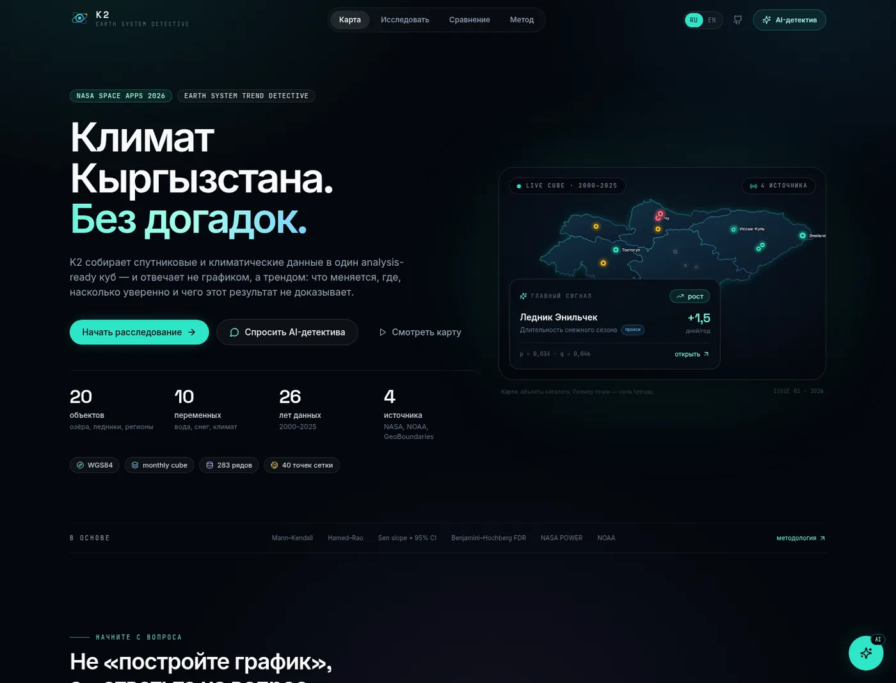
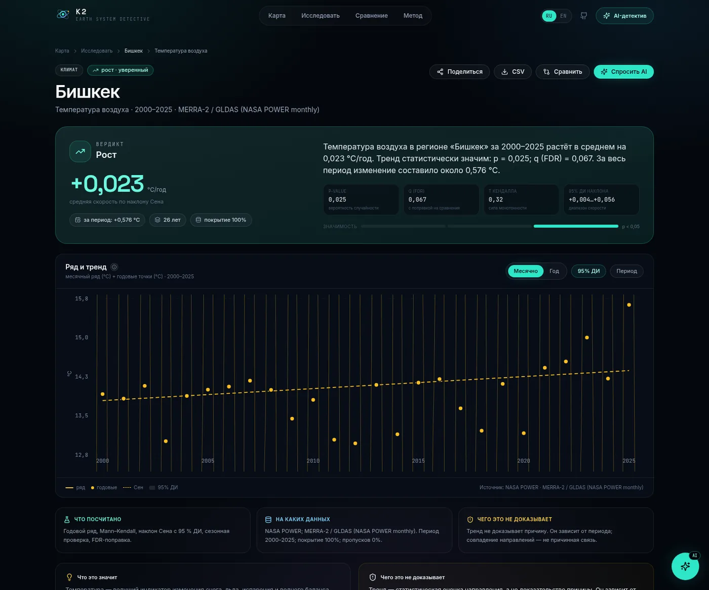

# K2 — Earth System Trend Detective

**Kyrgyzstan's climate. No guesswork.**

K2 is an MVP platform for the **NASA Space Apps Challenge 2026** (track *Be an Earth System Trend Detective!*). It turns open satellite and climate data into one analysis-ready cube for Kyrgyzstan and answers with a trend — not just a chart: **what is changing, where, how confidently, and what the result does not prove**.

**Team K2:** [spaceappschallenge.org/2026/find-a-team/2317](https://www.spaceappschallenge.org/2026/find-a-team/2317/?tab=members)  
**Repository:** [github.com/Abdihamitov/nasa-space](https://github.com/Abdihamitov/nasa-space)  
**Live demo:** [k2-earth.vercel.app](https://k2-earth.vercel.app)  
**Interface languages:** Russian + English (RU/EN switch in the header).



---

## English summary (for judges)

K2 is a bilingual (RU/EN) climate-trend detective for Kyrgyzstan. It combines NASA POWER (MERRA-2 / GLDAS / GPM IMERG) and NOAA data into a precomputed monthly cube (20 objects, 10 variables, 40 grid points, 2000–2025, 283 series). The core is a statistically honest pipeline: annual aggregation, Mann–Kendall with a full Hamed–Rao variance correction, seasonal MK as a robustness check, Sen slope with a 95% CI, and Benjamini–Hochberg FDR (p and q shown side by side). Every result includes three lines: what was computed, on what data, and what it does **not** prove.

The product has five screens: a phenomena map, a step-by-step explorer, an analysis result with a hypothesis chain, a region comparison with automatic opposite-trend pair selection, and a methodology page. A built-in AI detective sees the current object, variable, period and result; it can also compute a requested trend server-side (e.g. “analyse Naryn precipitation for 2010–2020”) and explain the actual p, q and Sen slope. The app is deployable on Vercel; Supabase is optional and prepared for chat history and exploration analytics.

> K2 is a research tool, not a forecast. Trends depend on the chosen period; matching directions do not prove causation.



---

## 1. The problem and the product

Climate data is scattered across dozens of portals and formats. Existing tools often show a chart but do not answer “is there a trend, is it significant, and what does it mean?”.

K2 reduces the path to an answer to four steps:

1. **Section** — water, snow & ice, climate, or global context.
2. **Place** — a catalog object (lake, glacier, region, city, river basin) or an arbitrary map point (nearest NASA POWER grid cell).
3. **Variable** — only combinations that actually have data.
4. **Period** — 2000–2025, at least 10 valid years for a trend test.

The result is not a raw chart. It is a verdict: direction, Sen slope, 95% CI, p, q, a plain-language summary, a hypothesis chain, provenance, a caveat, and a CSV export.

### Screens

| Route | What it does |
| --- | --- |
| `/` | Phenomena map: global warming, precipitation shift, snow season. Objects are ranked by local trend strength; click opens a local chart next to the global indicator. Period slider. |
| `/explore` | Step-by-step “section → place → variable → period”. Map point selection, URL state, only available combinations. |
| `/analysis` | Verdict, chart with monthly/annual data, Sen line and 95% CI, p/q, “years to significance”, hypothesis chain, details, CSV, share link. |
| `/compare` | Automatic pair with significant opposite trends; FDR-corrected table of all objects; manual pair replacement; honest fallback. |
| `/method` | Methodology, prewhitening vs variance correction, validation against pymannkendall, sources, limitations, FAQ. |
| AI dock | Context-aware assistant: explains the current result, decodes p/q, suggests the next click, and can run a requested analysis. |

---

## 2. What makes K2 different

### 2.1. An answer, not another dashboard

K2 generates the verdict from the statistics. The summary contains the direction, rate with units, significance, the change over the period, and an explicit caveat. Numbers in the text come from the same `TrendStats` object as the “Details” block and the CSV — they cannot drift apart.

### 2.2. Methodological honesty

The project follows the critique of the original TZ:

- **No gap filling.** Mann–Kendall works with gaps; interpolation would add artificial autocorrelation and inflate significance.
- **No outlier deletion.** Extremes are the signal (floods, heatwaves, anomalous years). The Sen slope is robust to them.
- **No causal chain.** The “chain” is a fixed hypothesis graph from the literature. Each link shows the trend sign, significance and status (“agrees / contradicts / weak / no trend / no data”). Wording is “is consistent with”, not “proves”.
- **FDR correction.** Every mass scan (map, compare, table) applies Benjamini–Hochberg and shows q next to p.
- **Minimum 10 years.** A shorter series returns “not enough data”, not a trend.
- **Regulated objects are marked.** Toktogul Reservoir is flagged; its level reflects hydropower operations.
- **Proxies are marked.** Snow depth/snow days are modelled proxies; the Issyk-Kul level is a reconstruction; MODIS snow is not glacier mass.
- **Three lines on every result:** what was computed, on what data, what it does not prove.

### 2.3. AI that understands the product

The AI assistant is not a generic chat window. It receives:

- the current route, object, variable, period and summary;
- the catalog (objects, variables, units, proxies, caveats);
- the methodology and limitations;
- recent explorations from `localStorage`.

When a user asks about a concrete object/variable/period, the server runs the same trend engine and injects the actual result into the model context. Example: “Analyse Naryn precipitation for 2010–2020” returns the real p = 0.755, q = 0.844, Sen slope = 4.5 mm/year and “no trend” — not a guess. The assistant then suggests concrete actions (open analysis, compare, method).

The OpenRouter key is **server-side only**. If the key is missing or the service is down, a deterministic fallback still explains the product and suggests navigation.

---

## 3. Data cube

### 3.1. Sources

| Source | What we use | Details | License |
| --- | --- | --- | --- |
| **NASA POWER** | Temperature, precipitation, soil moisture, evaporation, snow depth, snowfall | MERRA-2 / GLDAS / GPM IMERG; 0.25°–0.5°; monthly; 2000–2025 | NASA Open Data |
| **NOAA NCEI** | Global temperature anomaly | NOAAGlobalTemp v6; monthly | Public domain |
| **NOAA GML** | CO₂ concentration | Mauna Loa; monthly | Public domain |
| **GeoBoundaries** | 7 ADM1 region boundaries | WGS84; ODbL | ODbL 1.0 |
| **Zhang et al. (2022)** | Issyk-Kul level anchors | Reconstruction from in situ + CryoSat-2 + ICESat-2; **not raw Hydroweb** | CC BY 4.0 |
| **Collaud Coen et al. (2020)** | Prewhitening methodology reference | Atmos. Meas. Tech. 13, 6945–6964 | CC BY 4.0 |

### 3.2. Objects

- **Lakes:** Issyk-Kul, Son-Kul, Chatyr-Kul.
- **Reservoir:** Toktogul (marked as regulated).
- **River basins:** Naryn, Chu.
- **Glaciers:** Enilchek, Petrov, Ak-Shyirak, Golubina.
- **Regions:** Chuy, Talas, Jalal-Abad, Osh, Batken, Naryn, Issyk-Kul.
- **Cities:** Bishkek, Osh.
- **Global:** Earth (global temperature anomaly, CO₂).
- **Grid:** 40 NASA POWER points for arbitrary map clicks.

### 3.3. Variables

| Section | Variable | Unit | Source | Annual aggregation |
| --- | --- | --- | --- | --- |
| Water | Lake level (Issyk-Kul) | m | Reconstruction (Zhang et al.) | Mean |
| Water | Soil moisture | % | NASA POWER | Mean |
| Water | Evaporation | mm/month | NASA POWER | Sum |
| Snow & ice | Snow depth | cm | NASA POWER | Mean |
| Snow & ice | Snowfall | mm/month | NASA POWER | Sum |
| Snow & ice | Snow-season length | days/year | NASA POWER daily SNODP (derived) | Mean |
| Climate | Air temperature | °C | NASA POWER | Mean |
| Climate | Precipitation | mm/month | NASA POWER | Sum |
| Global | Global temperature anomaly | °C | NOAA NCEI | Mean |
| Global | CO₂ | ppm | NOAA GML | Mean |

### 3.4. What is real and what is reconstructed

- **Real:** NASA POWER fields, NOAA global series, GeoBoundaries.
- **Reconstruction:** Issyk-Kul level. The UI labels it, the caveat says to use Hydroweb/DAHITI for official work.
- **Not included:** MODIS NDVI and snow cover. The public ORNL subset API takes ~60 s per point-year for a 26-year series; a reproducible build for many objects would take hours. Snow-season length is derived from daily NASA POWER snow depth and explicitly marked as a proxy. This is a roadmap item, not a hidden substitution.

### 3.5. Files

| File | Contents |
| --- | --- |
| `data/catalog.json` | Sections, variables, objects, series index, phenomena, chains, English descriptions, meta |
| `data/series.json` | Normalized series keyed by `object|variable` |
| `data/geo/kyrgyzstan.json` | 7 region polygons (d3-geo winding) |
| `data/meta.json` | Compact build metadata |
| `data/README.md` | Data provenance and regeneration notes |

---

## 4. Methodology

### 4.1. Pipeline

```
monthly cube
  → annual aggregation (mean / sum / max by variable)
  → Mann–Kendall
  → full Hamed–Rao variance correction when autocorrelation is significant
  → Sen slope + 95% confidence interval
  → seasonal Mann–Kendall (Hirsch–Slack) as a robustness check
  → Benjamini–Hochberg FDR (p and q)
  → plain-language summary + caveat + “years to significance”
```

### 4.2. Mann–Kendall implementation

- S statistic over all pairs, tie-corrected variance.
- Continuity correction for Z.
- Two-sided p-value via the normal distribution.
- **Hamed–Rao (1998) full variance correction**: detrend with the Sen slope, rank the detrended series, compute the autocorrelation of the ranks, and inflate the variance using all significant lags. This is not a lag-1 approximation.
- Kendall τ is reported as tau-a (the pymannkendall convention); ties are still accounted for in var(S).

### 4.3. Validation against pymannkendall

The same annual series from the cube were run through Python `pymannkendall` (`hamed_rao_modification_test`, α = 0.05):

| Series | p (K2) | p (pymannkendall) | τ | Sen slope |
| --- | --- | --- | --- | --- |
| Bishkek · temperature, 2000–2025 | 0.024561 | 0.024561 | 0.3169 | 0.02303 °C/year |
| Issyk-Kul · level, 2000–2025 | 0.874314 | 0.874314 | −0.0431 | −0.00294 m/year |
| Enilchek · snow season, 2000–2025 | 0.034172 | 0.034172 | 0.4031 | 1.47059 days/year |

The last digit of p differs only because of the normal-CDF approximation. The regression tests in `lib/stats.test.ts` pin these values.

### 4.4. Prewhitening vs variance correction

Collaud Coen et al. (2020) show that prewhitening methods can reduce false positives but also remove a real trend and increase type II errors; TFPW-Y is especially prone to false positives. K2 uses the second class of methods — **variance inflation (Hamed–Rao)** — and applies it only when autocorrelation is significant. A seasonal MK test is computed as an independent check. The full 3PW pipeline (PW + TFPW-Y + VCTFPW) is a roadmap item; K2 does not claim to be 3PW.

### 4.5. Years to significance

For a non-significant trend, K2 extends the series with the current Sen slope plus resampled residuals and runs MK until p < 0.05 in at least 50% of simulations. The output is an **illustrative projection**, not a forecast; it is capped at 2050.

### 4.6. FDR

For a scan of N objects, p-values are corrected with Benjamini–Hochberg. The UI shows both p and q. A q above 0.05 can be a false discovery even if p is below 0.05.

---

## 5. AI assistant

### 5.1. What it can do

- Explain the current result in plain language.
- Decode p, q, Kendall τ, Sen slope, 95% CI and FDR.
- Say what the result does **not** prove.
- Suggest concrete next clicks (open analysis, compare regions, change period).
- Run a requested analysis: the server detects an object, variable and years in the message, calls the same trend engine, and injects the result into the model context.
- Answer in Russian or English, following the user's language.

### 5.2. Guardrails

- Numbers must come from the context or catalog; the prompt forbids invention.
- Only internal action links are allowed; years are clamped to 2000–2025.
- The model is told not to claim causation and to mention reconstruction/proxy/regulated caveats.
- Rate limit: 30 requests per 10 minutes per IP (in-memory).
- If OpenRouter is unavailable, a deterministic fallback still helps.

### 5.3. Model

- Provider: OpenRouter.
- Model: `deepseek/deepseek-v4.1-flash-1017`.
- Key: `OPENROUTER_API_KEY` (server only).
- Streaming: the API route proxies OpenRouter SSE to the client.

---

## 6. Architecture

```
etl/fetch_data.py          # NASA POWER / NOAA / GeoBoundaries → data/*.json
data/catalog.json          # catalog, objects, variables, phenomena, chains
data/series.json           # normalized monthly/annual cube
lib/stats.ts               # MK, full Hamed–Rao, seasonal MK, Sen, BH-FDR, Spearman
lib/trend.ts               # annual aggregation, analysis, RU/EN summaries, q-scan
lib/compare.ts             # auto pair, trend table, RU/EN difference text
lib/chain.ts               # hypothesis graph, statuses, correlations
lib/phenomena.ts           # phenomenon map, local trend strength
lib/i18n.ts                # RU/EN helpers and cookie name
lib/i18n-server.ts         # server locale from cookie
lib/assistant.ts           # system prompt and fallback
app/api/*                  # catalog, series, trend, trends, compare, chain,
                           # phenomena, export, health, chat, explore, feedback
app/(pages)                # /, /explore, /analysis, /compare, /method
components/                # map, charts, UI, AI dock, i18n switch
supabase/migrations/       # full schema + RLS
scripts/seed-supabase.ts   # idempotent catalog/cube seed
```

### Data flow

1. `etl/fetch_data.py` downloads and normalizes data, writes `data/*.json`.
2. The Next.js server imports the JSON cube; no NASA call happens on a user click.
3. `/api/trend` computes the analysis on demand from the cube.
4. The client renders the verdict, charts and chain.
5. The AI route enriches the model context with a server-side analysis when needed.
6. Supabase (optional) stores sessions, chat messages, explorations and feedback.

---

## 7. API

| Method | Path | Purpose |
| --- | --- | --- |
| GET | `/api/catalog` | Catalog |
| GET | `/api/series?object=&variable=&from=&to=` | Series |
| GET | `/api/trend?object=&variable=&from=&to=` | Analysis + summary |
| GET | `/api/trends?variable=&from=&to=&type=` | All objects + q |
| GET | `/api/compare?variable=&a=&b=&from=&to=` | Manual pair |
| GET | `/api/compare?variable=&from=&to=&auto=1` | Auto pair |
| GET | `/api/chain?object=&variable=&from=&to=` | Hypothesis chain |
| GET | `/api/phenomena?code=&from=&to=` | Phenomenon map |
| GET | `/api/phenomena?code=&object=&from=&to=` | Local + global series |
| GET | `/api/export?object=&variable=&from=&to=&lang=` | CSV with method, p/q, citation |
| GET | `/api/health` | Service status, build date, sources |
| POST | `/api/chat` | Streaming AI (OpenRouter) |
| POST | `/api/explore` | Log an exploration (Supabase) |
| POST | `/api/feedback` | Log feedback (Supabase) |

Errors use `{ code, message }`. “Not enough data” is a normal response, not a 500.

---

## 8. Local development

```bash
# 1. dependencies
npm install

# 2. environment
cp .env.example .env
# fill OPENROUTER_API_KEY, optional Supabase/NASA keys

# 3. data is already in data/. Rebuild the cube if needed:
python3 -m pip install -r etl/requirements.txt
python3 etl/fetch_data.py

# 4. development
npm run dev
# http://localhost:3000

# 5. production
npm run build && npm start
```

Node.js 20+ (tested on 22). Python 3.10+ only for the ETL.

### Environment variables

| Variable | Required | Purpose |
| --- | --- | --- |
| `OPENROUTER_API_KEY` | For AI | Server-side OpenRouter key |
| `LLM_MODEL` | No | Default `deepseek/deepseek-v4.1-flash-1017` |
| `LLM_BASE_URL` | No | `https://openrouter.ai/api/v1` |
| `LLM_MAX_TOKENS` | No | Response limit, default 1600 |
| `NEXT_PUBLIC_SITE_URL` | For OG/sitemap | Public app URL |
| `NEXT_PUBLIC_GITHUB_URL` | No | Repository link |
| `NEXT_PUBLIC_TEAM_URL` | No | Team K2 link |
| `NEXT_PUBLIC_SUPABASE_URL` | No | Supabase project URL |
| `NEXT_PUBLIC_SUPABASE_ANON_KEY` | No | Public anon key (future client) |
| `SUPABASE_SERVICE_ROLE_KEY` | For Supabase | Server-only analytics/seed |
| `EARTHDATA_API_KEY` | No | Future NASA ETL adapters |
| `EARTHDATA_TOKEN` | No | Future NASA ETL adapters |
| `VERCEL_TOKEN` | No | Manual CLI deploys only; never expose |

---

## 9. Supabase

The app works without Supabase. With it, K2 persists chat history and exploration analytics and has a production data model.

1. Create a project at [supabase.com](https://supabase.com).
2. Run `supabase/migrations/0001_init.sql` in the SQL Editor.
3. Add `NEXT_PUBLIC_SUPABASE_URL` and `SUPABASE_SERVICE_ROLE_KEY` to `.env` / Vercel.
4. Seed the cube:

```bash
npm run seed
```

The seed is idempotent: it upserts catalog rows, observations `(series_id, date)`, default 2000–2025 trends, chain links and phenomenon links.

Tables:

- analytics: `sessions`, `chat_messages`, `explorations`, `feedback`;
- catalog: `sections`, `sources`, `variables`, `objects`, `series`, `observations`, `trend_results`;
- hypotheses: `chain_templates`, `chain_links`;
- phenomena: `phenomena`, `phenomenon_objects`;
- `ingest_runs` and the `exploration_funnel` view.

RLS: catalog tables are public-read; analytics tables are service-role only.

---

## 10. Deploy to Vercel

**Live production:** https://k2-earth.vercel.app  
The Vercel project is linked to this GitHub repository; every push to `main` deploys automatically.

**One-click import:**  
https://vercel.com/new/clone?repository-url=https://github.com/Abdihamitov/nasa-space&project-name=k2

1. Push the repository to GitHub (already done: `Abdihamitov/nasa-space`).
2. Vercel → **New Project** → import the repository.
3. Framework: **Next.js**. Build command: `npm run build`.
4. Add environment variables:
   - `OPENROUTER_API_KEY`
   - `LLM_MODEL` (optional)
   - `NEXT_PUBLIC_SITE_URL` (your Vercel URL)
   - `NEXT_PUBLIC_GITHUB_URL`
   - `NEXT_PUBLIC_TEAM_URL`
   - Supabase keys if analytics is enabled.
5. Deploy. `vercel.json` sets the `fra1` region and a 60 s max duration for `/api/chat`.

The data cube is bundled with the app; the demo does not depend on live NASA/NOAA calls. This is intentional: AppEEARS tasks can take a long time, and Giovanni returns point series only.

---

## 11. Tests

```bash
npm run typecheck
npm test
npm run build
```

`lib/stats.test.ts` includes:

- normal CDF sanity checks;
- increasing / decreasing / noise series;
- exact Sen slope recovery;
- seasonal MK;
- BH-FDR;
- Spearman;
- **reference values from pymannkendall** for Bishkek temperature, Issyk-Kul level and Enilchek snow season.

`lib/trend.test.ts` covers:

- significant warming in Bishkek;
- no linear trend for the reconstructed Issyk-Kul level;
- insufficient data for a short period;
- the five-link lake hypothesis chain;
- automatic opposite-trend pair for precipitation;
- q-values in the trend table;
- at least five objects in the global-warming phenomenon map.

21 tests total.

---

## 12. Demo scenarios for judges

1. **Issyk-Kul → lake level → 2000–2025.** The series is non-linear: rising until 2011, then falling. The linear MK test is not significant (p = 0.874). A good example of period dependence.
2. **Bishkek → temperature → 2000–2025.** Significant warming, p ≈ 0.025, q ≈ 0.067 — an honest FDR conversation.
3. **Enilchek → snow-season length.** A proxy from modelled snow depth; the caveat explicitly says it is not glacier mass.
4. **Compare → precipitation.** A real opposite-trend pair: Chu basin (falling ~4.9 mm/year) vs Enilchek glacier (rising ~4.7 mm/year).
5. **Ask the AI:** “Why is there no trend at Issyk-Kul?” or “Analyse Naryn precipitation for 2010–2020.” The assistant uses the real computed numbers and explains p/q.

---

## 13. Limitations

- 0.25° is coarse for mountain valleys; a point is not a basin.
- Reanalysis/model output is not a field measurement.
- 2000–2025 is a short period; ENSO/NAO and other cycles can mask or amplify a trend.
- Toktogul is regulated; a climate trend there needs the hydropower context.
- FDR reduces the number of “significant” results — the price of fewer false discoveries.
- No causality: the chain is a hypothesis graph.
- Issyk-Kul level is a reconstruction, not raw Hydroweb.
- MODIS NDVI/snow cover are not included in this build; snow-season length is a modelled proxy.

---

## 14. Security

- `.env`, `.env.local` and `API.txt` are in `.gitignore`.
- The OpenRouter and Earthdata keys are server-side only.
- The chat endpoint has an in-memory rate limit and clamps action years to 2000–2025.
- The Supabase service role key must never be exposed to the client.
- **Rotate the OpenRouter key and Earthdata token** if they were shared outside the team (the original `API.txt` was a shared file).

---

## 15. Repository structure

```
app/                 Next.js App Router pages and API routes
components/          UI, map, charts, AI dock, i18n
lib/                 statistics, trend engine, catalog access, i18n, Supabase
data/                precomputed cube + GeoJSON + provenance
etl/                 Python ETL and requirements
scripts/             Supabase seed
supabase/            SQL migration and setup guide
public/              icon, manifest, screenshots
README.md            this document
LICENSE              MIT
```

---

## 16. Team K2

- NASA Space Apps Challenge 2026, track *Be an Earth System Trend Detective!*
- Team page: [spaceappschallenge.org/2026/find-a-team/2317](https://www.spaceappschallenge.org/2026/find-a-team/2317/?tab=members)
- Repository: [github.com/Abdihamitov/nasa-space](https://github.com/Abdihamitov/nasa-space)

## 17. License and credits

Code: MIT (`LICENSE`). Data belongs to its sources; citations are shown in the UI and CSV.

- NASA POWER: https://power.larc.nasa.gov/
- NOAA NCEI: https://www.ncei.noaa.gov/
- NOAA GML: https://gml.noaa.gov/ccgg/trends/
- GeoBoundaries: https://www.geoboundaries.org/
- Zhang et al. (2022), Remote Sensing 14(7), 1575: https://doi.org/10.3390/rs14071575
- Collaud Coen et al. (2020), Atmos. Meas. Tech. 13, 6945–6964: https://doi.org/10.5194/amt-13-6945-2020

> K2 is a research tool, not a forecast. Trends depend on the period; matching directions do not prove causation.
